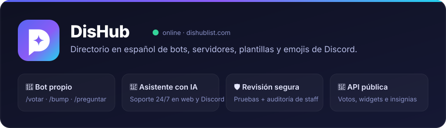

<div align="center">


<br/>

<a href="https://discord.gg/M68dTNRDnr"></a>
<a href="https://dishublist.com/?ref=github"></a>
<a href="https://disbuild.com/?ref=github"></a>
<a href="https://disguard.top/?ref=github"></a>
<a href="https://discord.com/users/1527853603757363436"></a>

</div>

---

### 👋 Hola, soy NyxSec

Desarrollador **full-stack** de España especializado en el ecosistema de **Discord**: webs, bots e integraciones con **IA**.
Me gusta construir productos completos, desde la base de datos hasta el último detalle visual, y que funcionen solos 24/7.

```ts
const nyxsec = {
  rol: "Fundador de DisSec Lab",
  proyectos: ["DisHub", "DisBuild", "DisGuard"],
  ahoraMismo: ["Haciendo crecer los tres proyectos", "Alianzas con comunidades de Discord"],
  stack: ["TypeScript", "Next.js", "React", "Node.js", "Python", "PostgreSQL"],
  contacto: "Discord → NyxSec | DisHub",
};
```

---

### 🏢 DisSec Lab

**DisSec Lab** es mi empresa: un laboratorio de herramientas para comunidades de **Discord**, en español y pensadas para funcionar solas 24/7.
Cada producto resuelve una parte de la vida de un servidor: **descubrirlo, crearlo y protegerlo**. Todos comparten equipo, soporte y un servidor central.

<a href="https://discord.gg/M68dTNRDnr"></a>

<a href="https://dishublist.com/?ref=github">
  
</a>

| Proyecto | Qué hace | Destacado | Estado |
|---|---|---|---|
| 🌐 **[DisHub](https://dishublist.com/?ref=github)** | Directorio en español para **descubrir y promocionar** bots, servidores, plantillas y emojis | Votos y rankings, comunidad con niveles y retos, bot propio, asistente con IA, API pública |  |
| 🏗️ **[DisBuild](https://disbuild.com/?ref=github)** | **Crea tu servidor de Discord con IA**: canales, roles, permisos, normas e icono en segundos | Diseño editable antes de construir, AutoMod en un clic, tokens semanales gratis |  |
| 🛡️ **[DisGuard](https://disguard.top/?ref=github)** | **Bot de seguridad 24/7**: anti-raid, anti-nuke, automod, anti-alt, verificación, tickets, logs y backups | Red de baneos compartida revisada por personas y panel web para configurarlo todo |  |

<details>
<summary><b>⚙️ Cómo están hechos</b></summary>

| | |
|---|---|
| 🌐 **Webs** | Next.js 16 (App Router, Server Actions), caché en el borde, imágenes OG dinámicas y temas festivos automáticos |
| 🤖 **Bots** | Interacciones por HTTP (sin servidor 24/7) en DisHub y DisBuild; discord.js con gateway en DisGuard |
| 🧠 **IA** | Asistentes con contexto (Hubi en DisHub, Bildi en DisBuild), diseño de servidores y preanálisis de seguridad |
| 🔗 **Central** | Roles de equipo sincronizados entre los tres proyectos y novedades unificadas en el servidor de DisSec Lab |
| ⚙️ **Infraestructura** | Prisma + PostgreSQL (Supabase), Auth.js con Discord, Netlify y Vercel, tareas programadas y alertas de errores en Discord |

</details>

### 🧩 Otros proyectos

| Proyecto | Qué es | Tecnología |
|---|---|---|
| [**stream-editor-ai-worker**](https://github.com/elysium081/stream-editor-ai-worker) | Worker en la nube para editar vídeo con IA, empaquetado en Docker y publicado en GHCR con GitHub Actions | Python · Docker · CI/CD |

---

### 🛠️ Tecnologías

<p>
  
  
  
  
  
  
  
  
  
  
  
  
  
  
  
</p>

---

### 📈 Actividad

<picture>
  <source media="(prefers-color-scheme: dark)" srcset="https://raw.githubusercontent.com/elysium081/elysium081/output/snake-dark.svg" />
  <source media="(prefers-color-scheme: light)" srcset="https://raw.githubusercontent.com/elysium081/elysium081/output/snake-light.svg" />
  
</picture>

---

<div align="center">

**¿Tienes un bot o un servidor de Discord?** Publícalo gratis en **[dishublist.com](https://dishublist.com/publish?ref=github)** 💜


</div>
