<div align="center">



<br/>

<a href="https://dishublist.com/?ref=github"></a>
<a href="https://discord.gg/UJCeuX4zb3"></a>
<a href="https://discord.com/users/1527853603757363436"></a>

</div>

---

### 👋 Hola, soy NyxSec

Desarrollador **full-stack** de España especializado en el ecosistema de **Discord**: webs, bots e integraciones con **IA**.
Me gusta construir productos completos, desde la base de datos hasta el último detalle visual, y que funcionen solos 24/7.

```ts
const nyxsec = {
  rol: "Fundador y desarrollador de DisHub",
  ahoraMismo: ["Haciendo crecer dishublist.com", "Lanzando DisGuard (disguard.top)", "Bots con IA para Discord"],
  stack: ["TypeScript", "Next.js", "React", "Node.js", "Python", "PostgreSQL"],
  contacto: "Discord → NyxSec | DisHub",
};
```

---

### 🚀 Proyecto principal

<a href="https://dishublist.com/?ref=github">
  
</a>

**[DisHub](https://dishublist.com/?ref=github)**: el directorio en español de **bots, servidores, plantillas y emojis** de Discord. Lo he diseñado y programado de principio a fin:

| | |
|---|---|
| 🌐 **Web** | Next.js 16 (App Router, Server Actions), caché en el borde, OG images dinámicas, modo festivo automático |
| 🤖 **Bot de Discord** | Interacciones por HTTP (sin gateway), `/votar`, `/bump`, `/preguntar`, comandos de moderación y anti-raid |
| 🧠 **IA** | Asistente «Hubi» con contexto de la web y escalado a tickets; preanálisis de seguridad de cada bot |
| 🛡️ **Moderación** | Revisión de bots con pruebas comprobadas en un servidor de pruebas, auditorías de staff, AutoMod y apelaciones |
| 🔌 **API pública** | Votos con webhooks, widgets SVG e insignias para desarrolladores |
| ⚙️ **Infraestructura** | Prisma + PostgreSQL (Supabase), Auth.js con Discord, Vercel, tareas programadas y alertas de errores en Discord |

<p>
  
  
  
  
</p>

### 🧩 Otros proyectos

| Proyecto | Qué es | Tecnología |
|---|---|---|
| [**DisGuard**](https://disguard.top/?ref=github) | Bot de seguridad para Discord en español: anti-raid, anti-nuke por minuto, automod, anti-alt, verificación, tickets, logs, backups y una red de baneos revisada por personas. Con panel web para configurarlo todo | Node.js · discord.js · Next.js · PostgreSQL |
| [**DisBuild**](https://disbuild.com/?ref=github) | Crea servidores de Discord completos (roles, canales y permisos) a partir de una descripción, con IA | Next.js · IA · Discord API · Stripe |
| [**stream-editor-ai-worker**](https://github.com/elysium081/stream-editor-ai-worker) | Worker en la nube para editar vídeo con IA, empaquetado en Docker y publicado en GHCR con GitHub Actions | Python · Docker · CI/CD |

---

### 🛠️ Tecnologías

<p>
  
  
  
  
  
  
  
  
  
  
  
  
  
  
  
</p>

---

### 📈 Actividad

<picture>
  <source media="(prefers-color-scheme: dark)" srcset="https://raw.githubusercontent.com/elysium081/elysium081/output/snake-dark.svg" />
  <source media="(prefers-color-scheme: light)" srcset="https://raw.githubusercontent.com/elysium081/elysium081/output/snake-light.svg" />
  
</picture>

---

<div align="center">

**¿Tienes un bot o un servidor de Discord?** Publícalo gratis en **[dishublist.com](https://dishublist.com/publish?ref=github)** 💜


</div>
